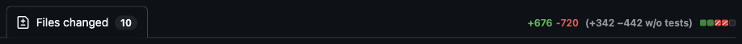
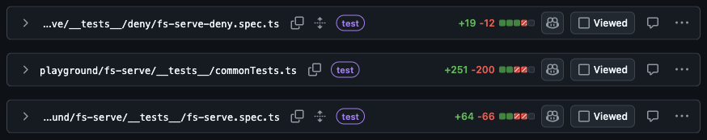
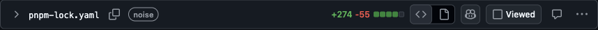
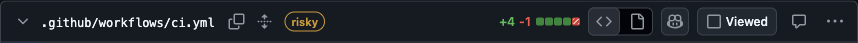
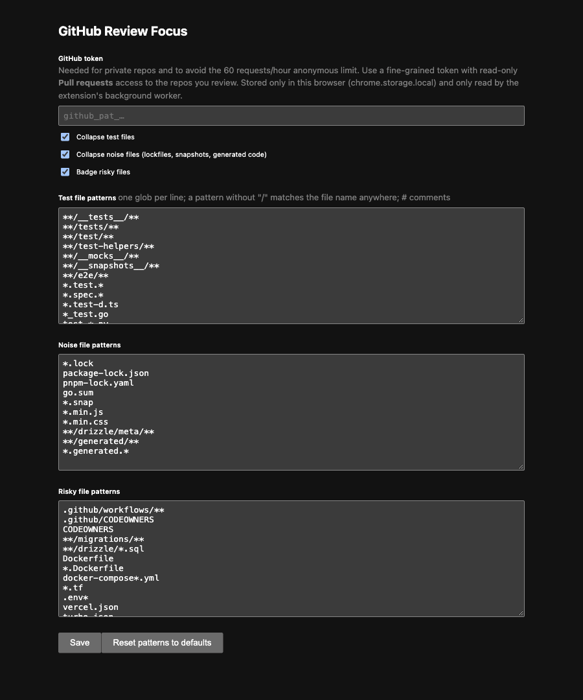

# GitHub Review Focus

A Chrome extension that makes GitHub pull request reviews calmer:

- **Collapses test files** when you open a PR's *Files changed* tab.
- **Shows line counts without tests** next to GitHub's own counter: `+559 −1,124 (+172 −913 w/o tests)`.
- **Collapses noise**: lockfiles, snapshots, generated code, ORM migration snapshots.
- **Badges risky files**: CI workflows, migrations, Dockerfiles, Terraform, env and deploy config.

Collapsing happens once per visit. Open a collapsed file and it stays open.

## Screenshots

Taken on public PRs with `scripts/screenshots.mjs`.

**Line counts without tests.** The bracket next to GitHub's own counter leaves out the 3 test files ([vitejs/vite#23855](https://github.com/vitejs/vite/pull/23855)):



**Test files collapsed and badged:**



**Lockfile collapsed as noise** ([vitejs/vite#23778](https://github.com/vitejs/vite/pull/23778)):



**Risky file badged.** A CI workflow change ([vitest-dev/vitest#11806](https://github.com/vitest-dev/vitest/pull/11806)):



**Options.** A token, three on/off switches, and the editable pattern lists:



Works on both GitHub *Files changed* pages: the new one (`/pull/N/changes`) and the classic one (`/pull/N/files`).

## Install

1. Clone this repo.
2. Open `chrome://extensions`, turn on **Developer mode**, click **Load unpacked**, and pick the repo folder.
3. Open the extension's **Options** and paste a GitHub token (see below).

### Token

The extension reads the PR's file list from the GitHub API (`GET /repos/{owner}/{repo}/pulls/{n}/files`).

- **Private repos need a token.** Without one the counter shows `(?)` and nothing collapses.
- Public repos work without one, but GitHub allows only 60 anonymous requests an hour.

Create a [fine-grained token](https://github.com/settings/personal-access-tokens/new) with read-only **Pull requests** access to the repos you review. The token is kept in `chrome.storage.local` in your browser. Only the extension's background worker reads it, and it is only sent to `api.github.com`.

## Patterns

All three lists are editable in Options. One glob per line:

- A pattern without `/` matches the file name in any folder: `*.test.*`, `bun.lock`.
- `**` matches any number of folders, `*` matches anything except `/`.

| List | Defaults |
|---|---|
| Tests | `**/__tests__/**`, `**/tests/**`, `**/test/**`, `**/test-helpers/**`, `**/__mocks__/**`, `**/__snapshots__/**`, `**/e2e/**`, `*.test.*`, `*.spec.*`, `*.test-d.ts`, `*_test.go`, `test_*.py`, `*_test.py` |
| Noise | `*.lock`, `package-lock.json`, `pnpm-lock.yaml`, `go.sum`, `*.snap`, `*.min.js`, `*.min.css`, `**/drizzle/meta/**`, `**/generated/**`, `*.generated.*` |
| Risky | `.github/workflows/**`, `.github/CODEOWNERS`, `CODEOWNERS`, `**/migrations/**`, `**/drizzle/*.sql`, `Dockerfile`, `*.Dockerfile`, `docker-compose*.yml`, `*.tf`, `.env*`, `vercel.json`, `turbo.json` |

A file that matches both the test and noise lists counts as a test. The `w/o tests` counter excludes test files only; noise files still count.

## How it works

- On both GitHub pages a file's element id is `diff-` + SHA-256 of its path. The extension hashes each path from the API and matches files by id, so it doesn't depend on how GitHub draws file names.
- A `MutationObserver` handles GitHub's client-side navigation and files that render late on big PRs.
- A click can land before GitHub's scripts are ready, and GitHub sometimes expands a file after loading its diff. So for 10 seconds after a file appears the extension keeps it collapsed. Your own click on a file's chevron ends that early.

Files: `src/content.js` (page logic), `src/patterns.js` (matching, unit-tested), `src/background.js` (API calls), `src/options.*` (settings).

## Development

```sh
npm install
npm test                       # pattern unit tests (node:test)
```

`scripts/` has the Playwright checks used to verify the extension in a real browser:

- `browser.sh` starts Chrome for Testing with the extension and DevTools on port 9333.
- `verify.mjs` reports each file's state and the counter for a PR.
- `compare.mjs` checks that report against `gh api` output.
- `verify-classic.mjs` checks the classic page, signed out.
- `screenshots.mjs` regenerates the images in `docs/`.

## Status

v0.1, verified by hand in Chrome for Testing 156:

- **New page:** checked on 3 PRs in a private monorepo (7, 14 and 52 files). Every file's collapsed state and badge matched the expected classification, and the counter matched the API totals. No console errors.
- **Classic page:** checked signed out on a public PR, with and without the extension.
- **Also checked:**
  - Client-side navigation from the Conversation tab.
  - A test file you re-open stays open.
  - Turning off "Collapse test files" in Options stops collapsing but keeps the badges.
  - The no-token error state.

Not built yet: lines-left-to-review, mark-viewed-by-pattern, and source↔test jump links.
